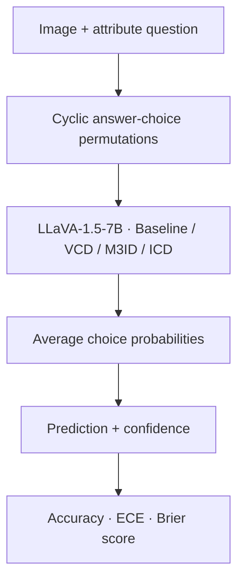
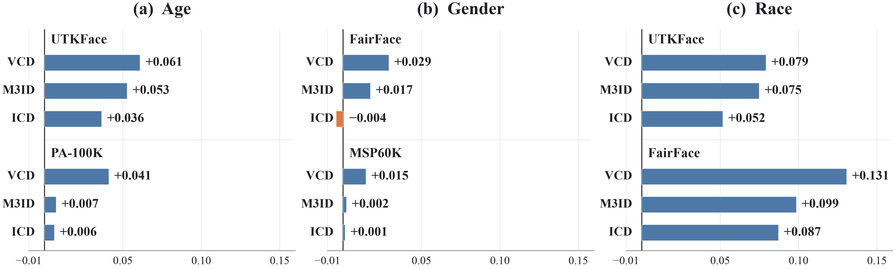
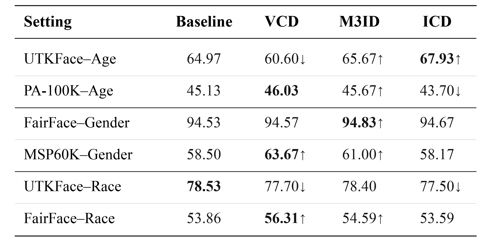
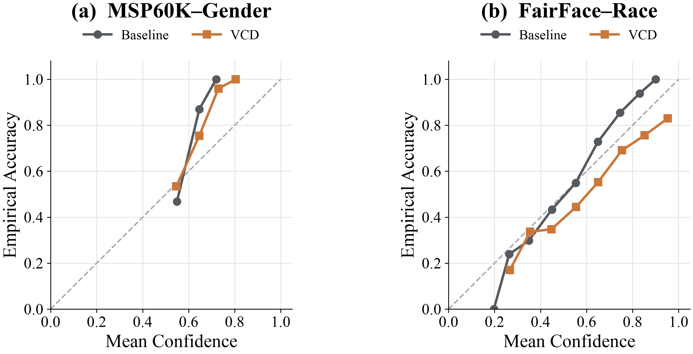
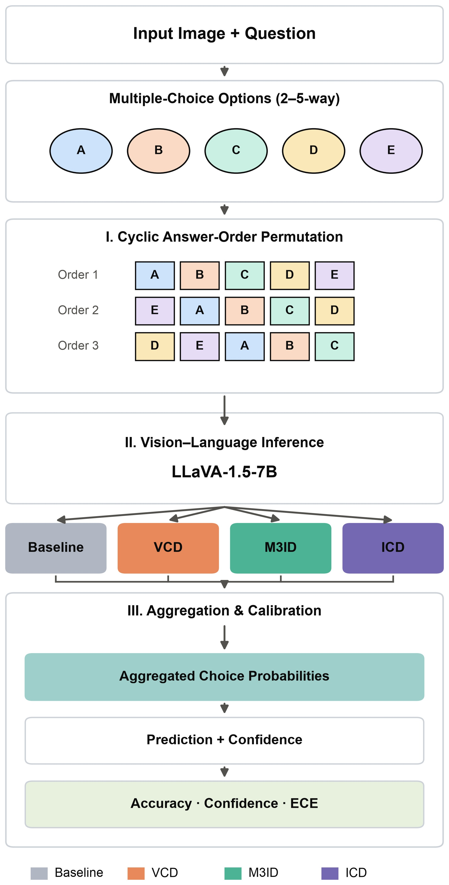
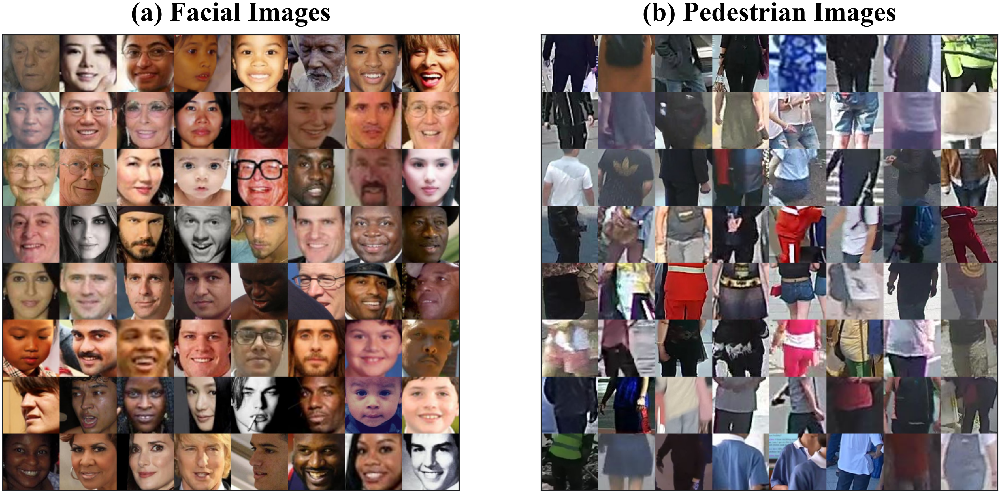
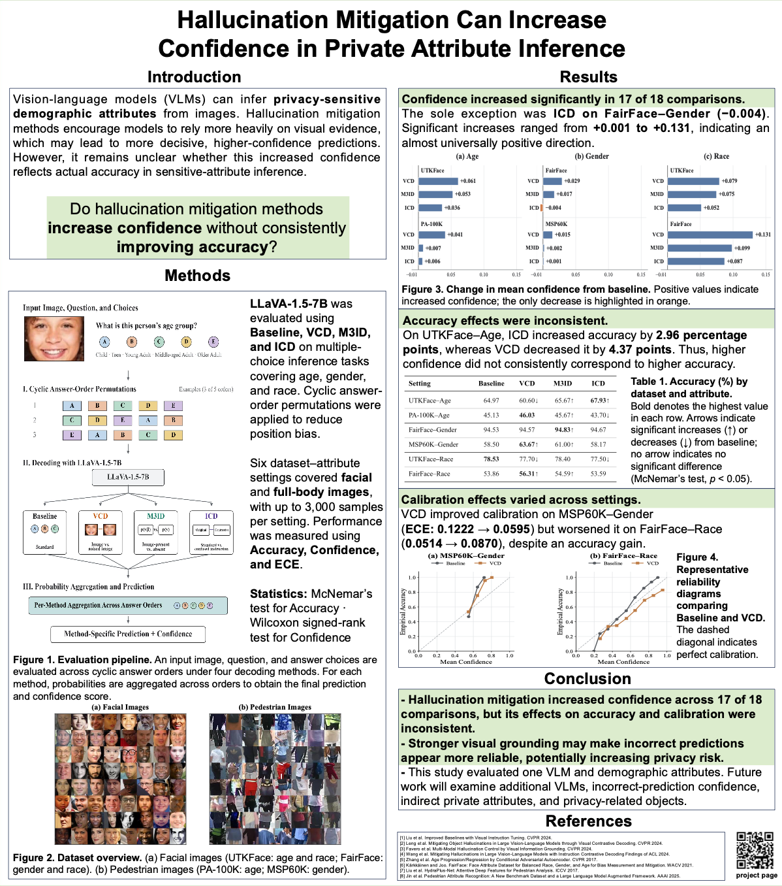

# VLM Privacy Evaluation

**Can hallucination mitigation make sensitive-attribute predictions look more reliable?**

Model evaluation · Confidence & calibration · USTC FUSEP 2026

[Pipeline](#evaluation-pipeline) · [Results](#reported-results) · [Quick start](#installation) · [Research poster](#research-poster)


## At a Glance

| Backbone | Comparison | Evaluation scope | Main finding |
| :--- | :--- | :--- | :--- |
| LLaVA-1.5-7B | Baseline, VCD, M3ID, ICD | 6 dataset–attribute tasks | Confidence ↑ in **17 / 18** comparisons |

This project examines how hallucination-mitigation decoding methods affect confidence, accuracy, and calibration when vision-language models infer age, gender, and race from facial and pedestrian images.

<a id="key-finding"></a>

> **Key finding:** Confidence increased in 17 of 18 comparisons against baseline, while accuracy and calibration changed inconsistently. Higher confidence did not reliably indicate more accurate or better-calibrated predictions.

The only confidence decrease was ICD on FairFace–Gender.

**Research context:** Conducted during the 2026 USTC Future Scientist Student Exchange Program (FUSEP) at the University of Science and Technology of China. My work focused on comparing decoding methods and evaluating their effects on sensitive-attribute inference.

## Evaluation Pipeline



Each image is evaluated with multiple-choice questions. Answer choices are cyclically permuted to reduce answer-position bias; probabilities are then averaged across permutations to obtain the final prediction and confidence.

| Method | Full name | Current choice-scoring implementation |
| :--- | :--- | :--- |
| Baseline | Standard model scoring | Clean-image logits |
| VCD | Visual Contrastive Decoding | Clean vs. diffusion-noised image logits |
| M3ID | Multi-Modal Mutual-Information Decoding | Black-image contrast with a fixed step proxy |
| ICD | Instruction Contrastive Decoding | Standard vs. disturbed-instruction logits |

**Implementation scope:** The main comparison uses choice-based metrics. Free-form generations are auxiliary outputs; ICD and M3ID use the clean image for those generations. M3ID is an approximation, not an exact image-removed autoregressive implementation. See [choice_scoring.py](src/choice_scoring.py).

## Reported Results

> **Result provenance:** The metrics, figures, and poster describe the original experiments. They have not been regenerated after the code fixes. The tables below are rounded directly from [final_metrics.csv](results/final_metrics.csv).

### Accuracy ↑

| Dataset / attribute | Baseline | VCD | M3ID | ICD |
| :--- | ---: | ---: | ---: | ---: |
| UTKFace · Age | 64.97% | 60.60% | 65.67% | **67.93%** |
| UTKFace · Race | **78.53%** | 77.70% | 78.40% | 77.50% |
| FairFace · Gender | 94.53% | 94.57% | **94.83%** | 94.67% |
| FairFace · Race | 54.19% | **57.03%** | 54.74% | 54.22% |
| PA-100K · Age | 45.13% | **46.03%** | 45.67% | 43.70% |
| MSP60K · Gender | 58.50% | **63.67%** | 61.00% | 58.17% |

Bold indicates the highest reported accuracy within each task; it does not imply a statistically significant difference.

### Confidence and Calibration

| Metric | Interpretation |
| :--- | :--- |
| Mean choice confidence | Average probability assigned to the predicted choice; higher is not inherently better |
| ECE ↓ | Expected Calibration Error with 10 bins; lower indicates better calibration under this metric |
| Multiclass Brier score ↓ | Squared error of the full probability distribution; lower is better |

<details>
<summary><strong>Mean choice confidence — all tasks</strong></summary>

| Dataset / attribute | Baseline | VCD | M3ID | ICD |
| :--- | ---: | ---: | ---: | ---: |
| UTKFace · Age | 49.75% | 55.85% | 55.02% | 53.40% |
| UTKFace · Race | 51.71% | 59.63% | 59.20% | 56.88% |
| FairFace · Gender | 70.53% | 73.44% | 72.26% | 70.08% |
| FairFace · Race | 52.13% | 65.15% | 62.04% | 60.88% |
| PA-100K · Age | 44.39% | 48.49% | 45.13% | 45.01% |
| MSP60K · Gender | 57.75% | 59.21% | 57.96% | 57.88% |

</details>

<details>
<summary><strong>ECE — all tasks (lower is better)</strong></summary>

| Dataset / attribute | Baseline | VCD | M3ID | ICD |
| :--- | ---: | ---: | ---: | ---: |
| UTKFace · Age | 0.1521 | **0.0585** | 0.1109 | 0.1460 |
| UTKFace · Race | 0.2756 | **0.1837** | 0.1953 | 0.2097 |
| FairFace · Gender | 0.2400 | **0.2112** | 0.2257 | 0.2458 |
| FairFace · Race | **0.0581** | 0.0813 | 0.0730 | 0.0665 |
| PA-100K · Age | 0.0849 | **0.0782** | 0.0929 | 0.1147 |
| MSP60K · Gender | 0.1222 | **0.0595** | 0.0928 | 0.1255 |

Bold indicates the lowest reported ECE per task.

</details>

<details>
<summary><strong>Multiclass Brier score — all tasks (lower is better)</strong></summary>

| Dataset / attribute | Baseline | VCD | M3ID | ICD |
| :--- | ---: | ---: | ---: | ---: |
| UTKFace · Age | 0.4984 | 0.5124 | 0.4782 | **0.4696** |
| UTKFace · Race | 0.4114 | 0.3825 | **0.3690** | 0.3911 |
| FairFace · Gender | 0.2085 | **0.1833** | 0.1899 | 0.2118 |
| FairFace · Race | 0.5951 | 0.5918 | **0.5915** | 0.5967 |
| PA-100K · Age | 0.6104 | 0.6064 | **0.6052** | 0.6112 |
| MSP60K · Gender | 0.4514 | **0.4360** | 0.4458 | 0.4526 |

Bold indicates the lowest reported Brier score per task.

</details>

VCD on MSP60K–Gender illustrates an improvement: accuracy rises from **58.50% to 63.67%** while ECE falls from **0.1222 to 0.0595**. This pattern does not hold uniformly: on FairFace–Race, VCD increases accuracy and confidence while ECE worsens.

The original analysis also reports continuity-corrected McNemar tests for accuracy and Wilcoxon signed-rank tests for confidence. Exact values, baseline deltas, and p-values are available in [CSV](results/final_metrics.csv) and [JSON](results/final_metrics.json).

<details>
<summary><strong>Original result figures</strong></summary>

**Confidence changes**



**Accuracy**



**Calibration**



</details>

## Evaluation Settings

| Image type | Dataset | Attribute | Classes | Samples |
| :--- | :--- | :--- | ---: | ---: |
| Facial | UTKFace | Age | 5 | 3,000 |
| Facial | UTKFace | Race | 5 | 3,000 |
| Facial | FairFace | Gender | 2 | 3,000 |
| Facial | FairFace | Race | 7 | 2,925 |
| Pedestrian | PA-100K | Age | 3 | 3,000 |
| Pedestrian | MSP60K | Gender | 2 | 600 |

Raw dataset images are not included. Evaluation annotations are provided under [data/](data/).

<details>
<summary><strong>Original pipeline and dataset figures</strong></summary>





</details>

## Installation

Inference requires access to the LLaVA model weights and sufficient device memory. The repository does not specify a measured minimum VRAM requirement. The example commands assume a Unix-like shell; CUDA availability depends on your PyTorch installation.

Create a virtual environment and install the required packages:

```bash
python3 -m venv .venv
source .venv/bin/activate

python -m pip install --upgrade pip
python -m pip install -r requirements.txt
```

The default model is:

```text
llava-hf/llava-1.5-7b-hf
```

## Running an Experiment

The following example evaluates all four methods on UTKFace age inference:

```bash
python run_experiment.py \
  --annotations data/utkface/annotations_age.json \
  --image-dir /path/to/UTKFace/images \
  --results-dir results/utkface_age \
  --methods baseline vcd m3id icd \
  --resume
```

Replace `/path/to/UTKFace/images` with the local path to the dataset images. The included annotation paths must resolve against that image directory.

For a small pilot run, add `--limit 10` and use a separate results directory. A pilot checks the execution path; its metrics are not the full-study results.

Each run writes `pilot_predictions.jsonl`, `pilot_metrics.json`, and `run_metadata.json`. `--resume` requires matching settings and implementation versions. Use a new results directory after changing implementation versions; `--overwrite` replaces an existing run.

Available methods:

```text
baseline vcd m3id icd
```

Useful options:

```text
--limit N
--device DEVICE
--load-in-4bit
--resume
--overwrite
--seed 42
```

Run-level prediction files and metadata are stored locally and excluded from Git.

## Testing

Run the tests with:

```bash
python -m pytest tests
```

## Rebuilding Final Metrics

<details>
<summary><strong>Rebuild from original prediction files</strong></summary>

Rebuilding requires the original prediction JSONL files, which are not included in this repository. Experiment folder mappings are defined in `configs/final_experiments.json`:

```bash
python scripts/build_final_metrics.py --config configs/final_experiments.json --results-root results
```

This updates:

```text
results/final_metrics.csv
results/final_metrics.json
```

The script uses samples with paired predictions from Baseline, VCD, M3ID, and ICD.

</details>

<details>
<summary><strong>Repository structure</strong></summary>

## Repository Structure

```text
vlm-privacy/
├── assets/
│   ├── figures/                 # Figures used in this README
│   └── poster/
│       └── research_poster.png
├── configs/
│   └── final_experiments.json   # Experiment folder mappings
├── data/
│   ├── fairface/                # Gender and race annotations
│   ├── msp60k/                  # Gender annotations
│   ├── pa100k/                  # Age annotations
│   └── utkface/                 # Age and race annotations
├── results/
│   ├── final_metrics.csv
│   └── final_metrics.json
├── scripts/
│   ├── analyze_results.py
│   ├── build_final_metrics.py
│   ├── build_utkface_annotations.py
│   └── validate_predictions.py
├── src/
│   ├── baseline_inference.py
│   ├── choice_scoring.py
│   ├── evaluate.py
│   ├── icd_inference.py
│   ├── m3id_inference.py
│   ├── model_loader.py
│   ├── vcd_core.py
│   └── vcd_inference.py
├── tests/
│   ├── test_experiment_regressions.py
│   └── test_vcd_core.py
├── requirements.txt
└── run_experiment.py
```

</details>

## Data Availability

Raw dataset images are not distributed in this repository. Users must obtain UTKFace, FairFace, PA-100K, and MSP60K from their official sources and comply with each dataset's license and terms of use.

The files under `data/` provide the evaluation annotations used in this study.

## Responsible Use

This repository is intended for research on privacy risks and vision-language model behavior. It should not be used to infer sensitive attributes about individuals for surveillance, profiling, access control, employment, healthcare, or other real-world decision-making.

## Limitations

This study evaluates one vision-language model family and multiple-choice demographic-attribute inference.

Results may differ for:

- Other VLMs
- Open-ended generation
- Different prompt formats
- Indirect private attributes
- Privacy-related objects
- Other demographic or contextual attributes

## Research Poster

<p align="center">
  <a href="assets/poster/research_poster.png">
    
  </a>
</p>

<p align="center">
  <sub>
    Research poster prepared for the 2026 USTC Future Scientist Student Exchange Program.
  </sub>
</p>

## References

1. Liu et al. **Improved Baselines with Visual Instruction Tuning.** CVPR, 2024.
2. Leng et al. **Mitigating Object Hallucinations in Large Vision-Language Models through Visual Contrastive Decoding.** CVPR, 2024.
3. Favero et al. **Multi-Modal Hallucination Control by Visual Information Grounding.** CVPR, 2024.
4. Wang et al. **Mitigating Hallucinations in Large Vision-Language Models with Instruction Contrastive Decoding.** Findings of ACL, 2024.
5. Zhang et al. **Age Progression/Regression by Conditional Adversarial Autoencoder.** CVPR, 2017.
6. Kärkkäinen and Joo. **FairFace: Face Attribute Dataset for Balanced Race, Gender, and Age for Bias Measurement and Mitigation.** WACV, 2021.
7. Liu et al. **HydraPlus-Net: Attentive Deep Features for Pedestrian Analysis.** ICCV, 2017.
8. Jin et al. **Pedestrian Attribute Recognition: A New Benchmark Dataset and a Large Language Model Augmented Framework.** AAAI, 2025.


